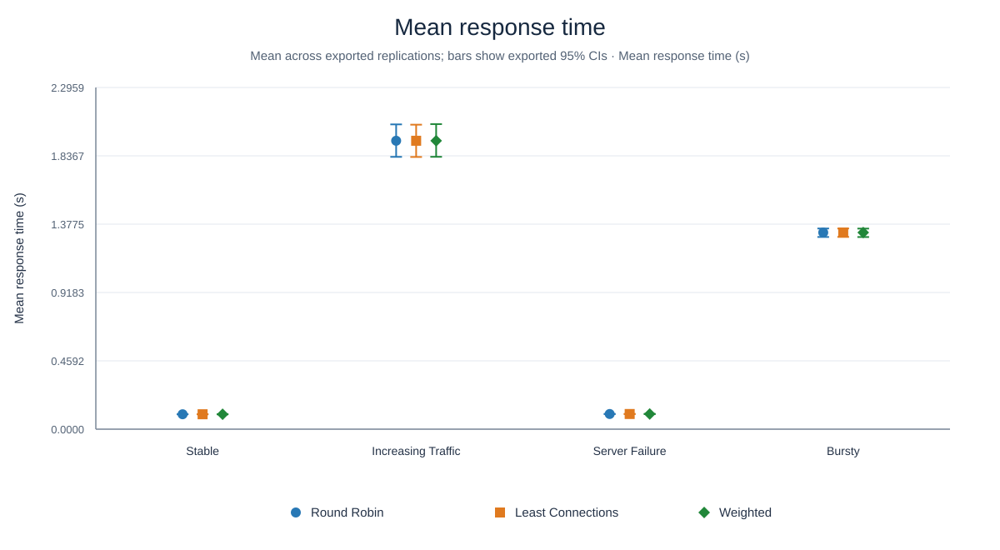
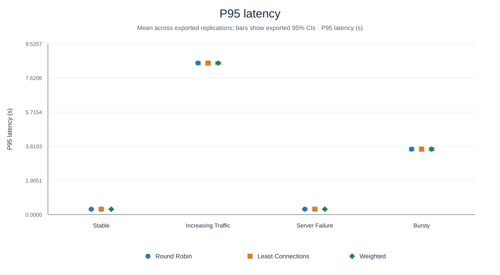
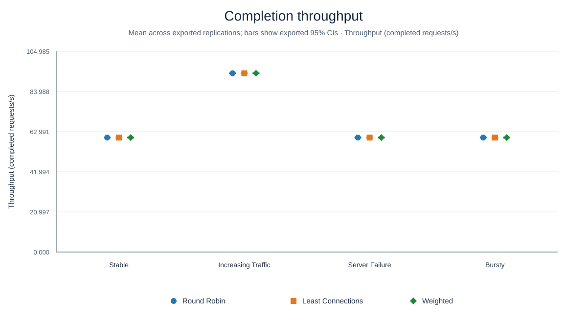
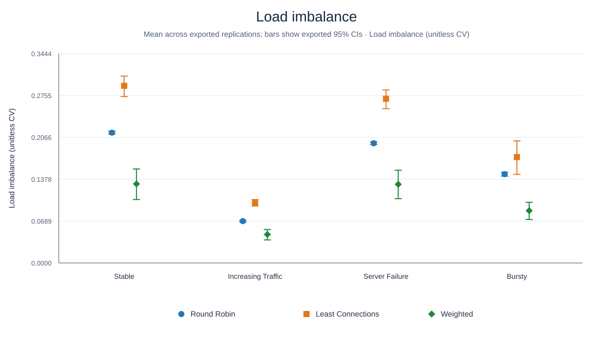
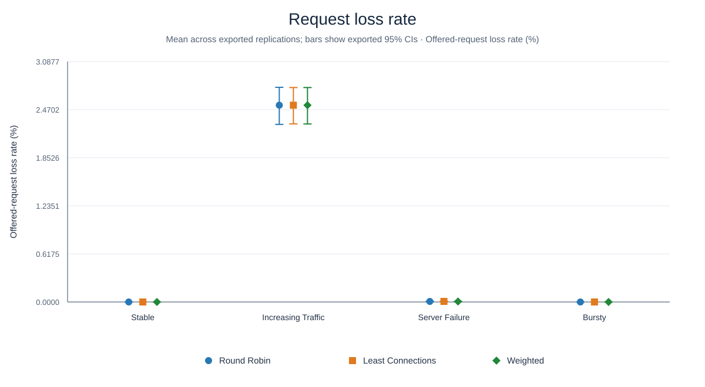
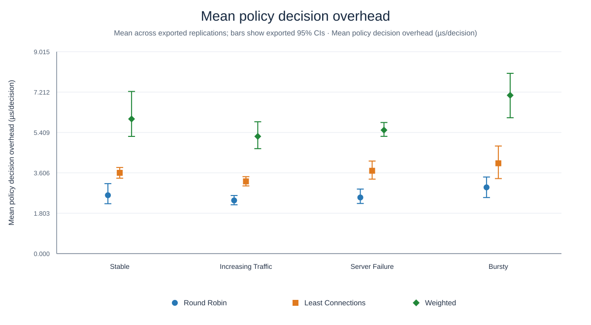

# Study B Load-Balancing Results

## Scope and provenance

These results compare the three implemented simulated routing policies across Stable, Increasing Traffic, Server Failure, and Bursty workloads. They are discrete-event simulation results, not physical network or hardware measurements. The source exports are preserved byte-for-byte in [`raw/`](raw/). They were found in `frontend/` and are copied there under the requested workload filenames.

The JSON structure is `{policy_id: {metric_name: {mean, standard_deviation, confidence_interval_95, sample_count}}}`. Each requested metric has a sample count of 10 per policy/workload. Each displayed mean summarizes replication-level metric values; the P95 column is the mean of per-replication P95 latency values, not a pooled-request percentile. Tables show the exported mean and its exported 95% confidence interval in brackets. The report does not recompute or alter those values.

The exports do not include per-replication observations, paired policy differences, seed IDs, trace IDs, or full run configuration. Therefore, paired confidence intervals cannot be independently reconstructed from these files. Overlap between separate policy intervals is not a formal test of equivalence or of a paired difference.

## Experimental results

### Mean response time (s)

| Workload | Round Robin | Least Connections | Weighted |
|---|---:|---:|---:|
| Stable | 0.1002 [0.0998, 0.1005] (n=10) | 0.1002 [0.0998, 0.1005] (n=10) | 0.1002 [0.0998, 0.1005] (n=10) |
| Increasing Traffic | 1.9380 [1.8298, 2.0480] (n=10) | 1.9380 [1.8290, 2.0460] (n=10) | 1.9380 [1.8301, 2.0499] (n=10) |
| Server Failure | 0.1019 [0.1013, 0.1025] (n=10) | 0.1019 [0.1013, 0.1024] (n=10) | 0.1019 [0.1013, 0.1025] (n=10) |
| Bursty | 1.3213 [1.2914, 1.3484] (n=10) | 1.3213 [1.2918, 1.3485] (n=10) | 1.3213 [1.2911, 1.3479] (n=10) |

### P95 latency (s)

| Workload | Round Robin | Least Connections | Weighted |
|---|---:|---:|---:|
| Stable | 0.2996 [0.2980, 0.3014] (n=10) | 0.2996 [0.2979, 0.3013] (n=10) | 0.2996 [0.2980, 0.3014] (n=10) |
| Increasing Traffic | 8.4486 [8.3897, 8.5051] (n=10) | 8.4486 [8.3876, 8.5042] (n=10) | 8.4486 [8.3868, 8.5042] (n=10) |
| Server Failure | 0.3026 [0.3005, 0.3047] (n=10) | 0.3026 [0.3004, 0.3047] (n=10) | 0.3026 [0.3005, 0.3047] (n=10) |
| Bursty | 3.6478 [3.5620, 3.7255] (n=10) | 3.6478 [3.5625, 3.7249] (n=10) | 3.6478 [3.5642, 3.7271] (n=10) |

### Completion throughput (requests/s)

| Workload | Round Robin | Least Connections | Weighted |
|---|---:|---:|---:|
| Stable | 59.897 [59.723, 60.086] (n=10) | 59.897 [59.723, 60.094] (n=10) | 59.897 [59.726, 60.079] (n=10) |
| Increasing Traffic | 93.536 [93.352, 93.736] (n=10) | 93.536 [93.356, 93.736] (n=10) | 93.536 [93.357, 93.735] (n=10) |
| Server Failure | 59.893 [59.719, 60.082] (n=10) | 59.893 [59.719, 60.089] (n=10) | 59.894 [59.723, 60.075] (n=10) |
| Bursty | 59.896 [59.721, 60.087] (n=10) | 59.896 [59.721, 60.094] (n=10) | 59.896 [59.724, 60.080] (n=10) |

### Load imbalance (CV)

| Workload | Round Robin | Least Connections | Weighted |
|---|---:|---:|---:|
| Stable | 0.2143 [0.2122, 0.2168] (n=10) | 0.2914 [0.2737, 0.3075] (n=10) | 0.1300 [0.1043, 0.1546] (n=10) |
| Increasing Traffic | 0.0688 [0.0675, 0.0702] (n=10) | 0.0992 [0.0937, 0.1042] (n=10) | 0.0469 [0.0380, 0.0550] (n=10) |
| Server Failure | 0.1969 [0.1948, 0.1994] (n=10) | 0.2702 [0.2539, 0.2846] (n=10) | 0.1294 [0.1058, 0.1526] (n=10) |
| Bursty | 0.1461 [0.1428, 0.1494] (n=10) | 0.1742 [0.1458, 0.2009] (n=10) | 0.0860 [0.0715, 0.0998] (n=10) |

### Request loss rate (% offered)

| Workload | Round Robin | Least Connections | Weighted |
|---|---:|---:|---:|
| Stable | 0.0000 [0.0000, 0.0000] (n=10) | 0.0000 [0.0000, 0.0000] (n=10) | 0.0000 [0.0000, 0.0000] (n=10) |
| Increasing Traffic | 2.5272 [2.2805, 2.7569] (n=10) | 2.5272 [2.2873, 2.7540] (n=10) | 2.5272 [2.2864, 2.7543] (n=10) |
| Server Failure | 0.0068 [0.0053, 0.0086] (n=10) | 0.0074 [0.0053, 0.0096] (n=10) | 0.0062 [0.0043, 0.0078] (n=10) |
| Bursty | 0.0000 [0.0000, 0.0000] (n=10) | 0.0000 [0.0000, 0.0000] (n=10) | 0.0000 [0.0000, 0.0000] (n=10) |

### Mean policy decision overhead (µs/decision)

| Workload | Round Robin | Least Connections | Weighted |
|---|---:|---:|---:|
| Stable | 2.606 [2.228, 3.124] (n=10) | 3.607 [3.368, 3.845] (n=10) | 6.012 [5.233, 7.240] (n=10) |
| Increasing Traffic | 2.375 [2.180, 2.594] (n=10) | 3.225 [3.022, 3.435] (n=10) | 5.233 [4.687, 5.887] (n=10) |
| Server Failure | 2.506 [2.238, 2.882] (n=10) | 3.700 [3.325, 4.132] (n=10) | 5.514 [5.235, 5.854] (n=10) |
| Bursty | 2.958 [2.503, 3.419] (n=10) | 4.033 [3.350, 4.803] (n=10) | 7.069 [6.066, 8.049] (n=10) |

## Workload-wise observations

- **Stable:** Weighted's load-imbalance CV is 0.1300, 39.3% vs Round Robin; 55.4% vs Least Connections. The three policies' mean-response-time means span 0.0000% and throughput means span 0.0000% of their respective across-policy averages. Weighted's mean decision overhead is 6.012 µs/decision.
- **Increasing Traffic:** Weighted's load-imbalance CV is 0.0469, 31.9% vs Round Robin; 52.7% vs Least Connections. The three policies' mean-response-time means span 0.0000% and throughput means span 0.0000% of their respective across-policy averages. Weighted's mean decision overhead is 5.233 µs/decision.
- **Server Failure:** Weighted's load-imbalance CV is 0.1294, 34.3% vs Round Robin; 52.1% vs Least Connections. The three policies' mean-response-time means span 0.0024% and throughput means span 0.0012% of their respective across-policy averages. Weighted's mean decision overhead is 5.514 µs/decision.
- **Bursty:** Weighted's load-imbalance CV is 0.0860, 41.1% vs Round Robin; 50.6% vs Least Connections. The three policies' mean-response-time means span 0.0000% and throughput means span 0.0000% of their respective across-policy averages. Weighted's mean decision overhead is 7.069 µs/decision.

## Interpretation

Across all four exported workloads, Weighted has the lowest mean load-imbalance CV. Its destination choice therefore distributes measured utilization more evenly under the supplied capacity-aware policy. Load balance measures utilization dispersion; it does not increase the fleet's aggregate service capacity. With the same offered work and server fleet, improved balance can therefore coexist with nearly unchanged response and completion throughput. In Increasing Traffic, the reported loss-rate means are also nearly identical across policies. This is a plausible interpretation of the observed pattern, not a causal result established by these aggregate exports. However, mean response-time, P95-latency, and throughput point estimates are effectively coincident across policies in these exports. The results do not show a meaningful latency or throughput advantage for Weighted. The generated observations quantify the across-policy point-estimate spreads for each workload. This is a descriptive reading, not a paired significance test, because replication-level paired differences were not exported.

Weighted also has the largest mean policy decision overhead in each workload in the provided summaries. These are host wall-clock measurements and should be interpreted as implementation overhead, not simulated server CPU or simulation-time delay.

Increasing Traffic has the highest mean response time and P95 latency among the workloads, accompanied by the largest reported request-loss rate. Bursty traffic raises latency relative to Stable while the reported loss rate remains zero. The Server Failure scenario reports a small nonzero loss rate. Workload-level values and confidence intervals are shown in the tables above.

## Statistical uncertainty

The exports provide per-policy 95% confidence intervals for each metric, based on 10 samples. The repository [comparison routine](../../backend/app/simulation/comparison.py) uses 10,000-resample percentile bootstrap intervals; these exported intervals are reproduced as supplied. They are not paired-difference intervals. Since paired scenario observations are absent, the report makes no formal claim that policy differences are statistically significant or equivalent.

## Limitations

- Results are from a discrete-event simulation; no physical network behavior, hardware CPU use, or hardware memory use is measured.
- The files contain aggregate summaries only. Per-replication values and paired differences are unavailable, limiting independent verification and comparative inference.
- Seeds, trace identifiers, detailed run configuration, and environment metadata are absent from the exports, so this report cannot independently verify that all policy runs used identical paired scenarios.
- Decision-overhead timings depend on the host and runtime and should not be treated as simulated server resource consumption.
- Confidence intervals are reported as exported; they do not account for variation across workload definitions or establish generalization beyond these four scenarios.

## Final findings

1. Weighted shows the lowest load-imbalance CV in all four workload summaries.
2. The exported mean response time, P95 latency, and throughput are effectively the same across the three policies; these results do not demonstrate a meaningful latency or throughput improvement from Weighted.
3. Weighted's mean route-decision overhead is higher in the supplied summaries, which is a relevant trade-off for the capacity-aware policy.
4. Findings are limited to the supplied simulated experiment summaries and should not be generalized to physical networks or treated as formal paired significance claims without the replication-level exports.

## Reproduction

From the repository root, run `python docs/results/analyze_results.py`. The script reads the UTF-16 PowerShell exports in `docs/results/raw/`, validates the expected schema, and regenerates this file and all SVG figures in `docs/results/figures/`. It uses only the Python standard library.
